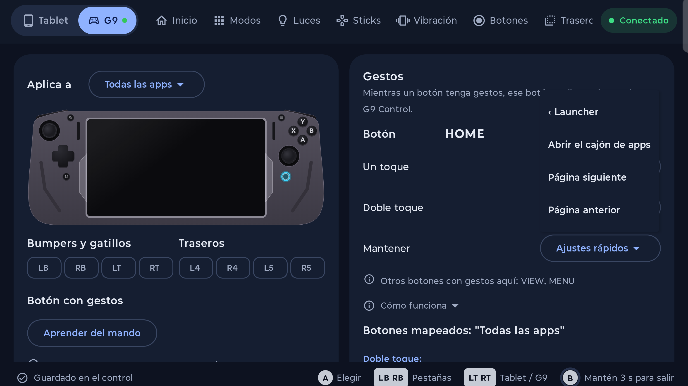
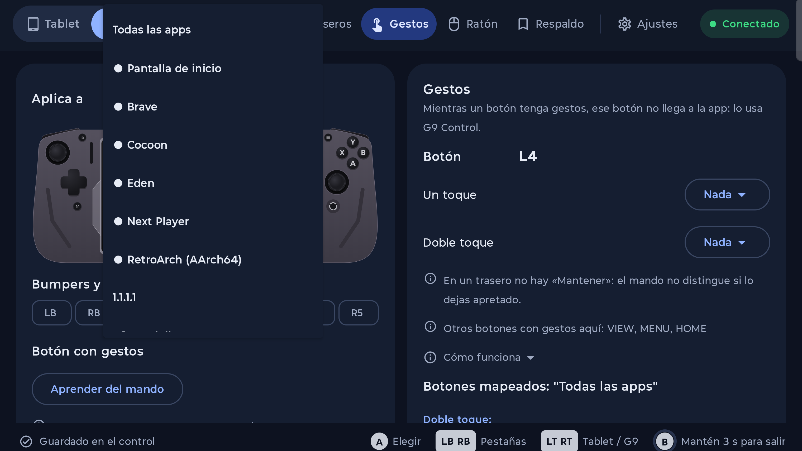
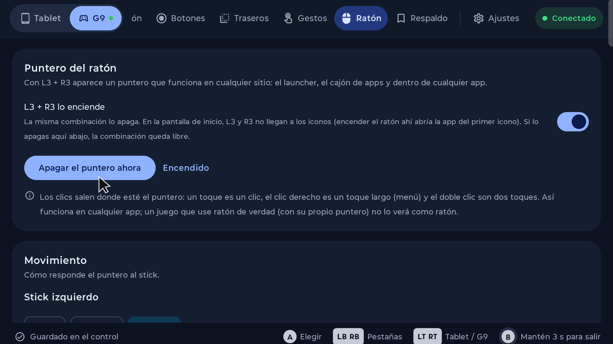
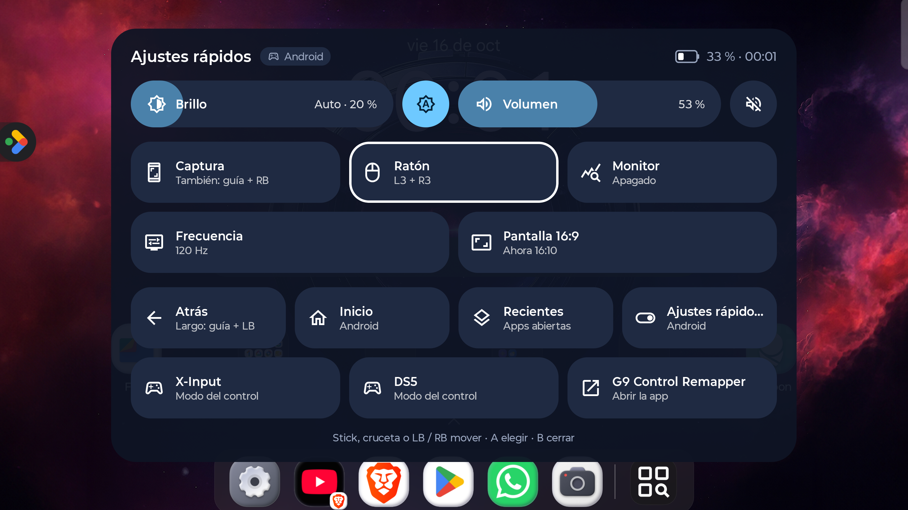

# G9 Control Remapper

**Button remapping for the Legion G9 controller on the Lenovo Legion Y700 tablet.** An independent
fork of [G9Control](https://github.com/sudo-diego/G9Control).

[Español](README.es.md)

> **This is a fork.** All of the groundwork —lights, sticks, vibration, profiles, game panel, per-app
> controller mode— comes from [sudo-diego's original project](https://github.com/sudo-diego/G9Control)
> (GPL-3.0). What **this** repo adds is the remapping: see "What this fork adds" below.
>
> **Not affiliated with Lenovo.** "Legion" and "Lenovo" are trademarks of Lenovo, and "GameSir" of
> GameSir. This is an independent, unofficial app: it talks to the controller over USB with a protocol
> reconstructed by studying the official app, and it contains no code or assets from it.

> **How it was made.** The code in this fork was written by an AI —**DeepSeek**, inside
> [Hermes Agent](https://hermes-agent.nousresearch.com)**— for Roberto, who tested every build on his
> own tablet and controller and reported what worked and what didn't. Every round is recorded, with
> its measurements, in [`PROGRESS.md`](PROGRESS.md) (in Spanish). (The original project was written by
> Claude Code.)

---

## What this fork adds

The original **configures** the controller. This fork turns it into a **remapper**: every button can
do something else, the behaviour can differ per app, and the controller can stand in for your finger
and for a mouse.

### 1. Button remapping — the "Gestures" page

- **Three gestures per button**: *tap*, *hold* and *double tap*, each with its own action. It works
  for any button, including bumpers, triggers, the guide button and the paddles.
- **Actions**, grouped by category in a two-step menu:
  - *System*: Back, Home, Recents, Notifications, Screenshot, Quick settings.
  - *Media*: play/pause, next and previous track, seek forward and back with a **swipe** or with a
    **double tap**, stop, mute, volume up and down.
  - *Screen*: brightness up and down.
  - *Apps*: open a specific app.
  - *Launcher*: open the app drawer, next page, previous page.
  - *Input*: a **keyboard key** (one per gesture) or a **key sequence**.
  - *Mouse*: click, right click, double click, drag and wheel (see point 3).
- **Per app** — the "Applies to" selector: *All apps* (a general rule) or one specific app. A given
  app's rules **override** the general ones and, with "Nothing" on all three gestures, the button
  **passes straight through** to the app, as if the app weren't installed.
- **Key Mapper–style interception**: a button with something assigned swallows the event; a button
  with nothing assigned goes straight to the game.
- **"Learn from the controller"**: you pick the button by pressing it instead of hunting for it in a
  list.
- **Per-app indicator**: the app selector shows which buttons already have rules there.

### 2. Paddles L4 / R4 / L5 / R5, each with its own command

The G9's firmware only lets a paddle **copy a button** (or run a macro) and, in practice, the four of
them are **indistinguishable**: measured with `getevent`, L4 sends exactly what the Y button sends.
That's why the original could only make a paddle copy something.

This fork gives **each paddle a signature**: a very short, unique macro (View→Menu, say, in 5 ms
steps) that the service **recognises on the way in and swallows**, so it knows **which** paddle was
pressed. That means:

- each paddle can have its **own command**, and
- each paddle can do **something different per app** — exactly what the firmware can't do alone,
  because the signature lives in the controller but the decision lives in the app.

The paddles go through the same gesture engine as every other button, so they're configured on the
same page with the same "Applies to" selector.

### 3. Mouse as an overlay — L3 + R3

A pointer **drawn by the app on top of the game** (in the spirit of Mantis Gamepad Pro) for whatever
only understands touch or a mouse, **with no root**:

- **click** where the pointer is, **right click** (the context menu), **double click** and **drag**,
  injected at the cursor's position;
- **wheel**, also assignable to the D-pad (this controller's D-pad arrives as an **axis**, not as
  keys, so it has its own code path);
- a **"Mouse"** page with speed/DPI, smoothing, curve and dead zone;
- the pointer is turned on and off with the button you choose and, **while it's on, the rest of the
  buttons belong to the mouse** (by design: otherwise every button would do two things at once).

### Extras that everyday use asked for

- **Keyboard keys and macros**: the controller does **not** send keyboard keys; the app injects them
  with Shizuku. Each gesture has its own.
- **Quick settings assignable to any button** (in the original, only the guide button or L3 + R3).
- **Other controllers**: if you connect a pad that isn't the G9 (tested with a GameSir Cyclone 2 over
  Bluetooth), none of the G9 behaviour applies to it: its guide button opens Quick settings and
  everything else goes straight through to the app.
- **Automatic reconnect** for the G9 when the tablet sleeps: Android drops the USB permission on
  disconnect and the app used to stay "disconnected" forever.
- **App drawer** with a self-check: the app looks at whether the drawer really opened and retries once
  if it didn't.
- **Full backup** to a file: profiles **and** app settings, also meant to avoid losing anything when
  the signing key changes.
- **Its own signing key** (not the debug one): `adb install -r` updates in place **keeping your data**.

---

## What came from the original project

Controller configuration, using the official app as reference and with no account:

| | |
|---|---|
| **Lights** | Both light strips and the Home button: static, breathing, rainbow, off; colour, speed and brightness. |
| **Sticks and triggers** | Inner and outer dead zones with a live preview, trigger ranges, hair trigger, drift measurement. |
| **Vibration** | Five levels per side, test with the triggers. |
| **Buttons** | Button test, A↔B / X↔Y swap, D-pad diagonal lock, left stick ↔ D-pad swap. |
| **Paddles** | Assign L4, R4, L5, R5 to any button (including Home and stick directions) or to a macro. |
| **Profiles** | Save, apply and back up complete configurations. |
| **Games** | Choose which mode each app opens in; the controller switches when you open it. |
| **Game panel** | Hold the Legion button (or L3 + R3) in any app: a panel like Android's quick settings, with brightness and volume sliders, screenshot, Game Assistant, performance, bypass, 16:9 screen, Back, Home, Recents, quick settings and controller mode. Use the stick, D-pad, LB/RB or touch, without taking focus from the game. |
| **Screenshots** | Game-only (no pointer or overlays), with a thumbnail notice and a sound like the Switch. Legion + RB (hold RB for a burst) or holding L3 + R3. |
| **Performance monitor** | A bar over the game with FPS, CPU (clock and temperature), GPU (load and temperature) and battery; turned on from the panel. FPS needs Shizuku. |
| **Performance** | Power saving, Balanced or Beast (Game Assistant's modes) from the controller, without touching the screen. Needs Shizuku. |
| **Bypass charging** | While gaming plugged in, the charger powers the tablet and the battery doesn't charge or heat up. Manual (also from the panel) or automatic, with the minimum battery and temperature you choose. Needs Shizuku. |
| **Charge limit** | While plugged in, at the level you choose (70 to 90 %) bypass turns on: the battery stops charging. ZUI's always stops at 80 %. Needs Shizuku. |
| **16:9 screen** | For an external monitor: the picture fills it with no borders. |
| **External monitor** | When connected in mirror mode it switches to 16:9 by itself and back to 16:10 when unplugged. |
| **Another controller** | If you play with another controller, the G9 doesn't switch mode or ask to go back to Android. |
| **Languages** | English and Spanish. |

---

## Status

- Version in development: **`1.4.17-diag`** (`versionCode` 44). The `-diag` suffix marks the
  diagnostic builds of the testing rounds on the tablet.
- Tested on: **Lenovo Legion Y700** (the original targets Gen 3; here it was tested on Gen 5) with the
  **2026 Legion G9 controller**.
- Android 15 / 16, `minSdk` 29. It needs the **accessibility service** to see the buttons and
  **Shizuku** for what Android won't let a normal app do (keyboard keys, app drawer, performance,
  bypass charging).
- **Published:** [release v1.4.17](../../releases/latest), with the signed APK ready to install. For
  automatic updates, add `https://github.com/Rarstorm/G9-Control-Remapper` in
  [Obtainium](https://github.com/ImranR98/Obtainium) (it follows GitHub releases). You can also build
  it yourself (see "Build from source").
- Every testing round, with its measurements, is in [`PROGRESS.md`](PROGRESS.md) (in Spanish).

## Install

1. Download the APK from [Releases](../../releases/latest) — or build it (see "Build from source").
2. `adb install -r app-release.apk` — or copy the APK to the tablet and open it (allow installing apps
   from that source if Android asks).
3. Open the app: the setup assistant asks for the **accessibility service** and, if you want the
   features that need it, **Shizuku**.
   - **Android 13+ blocks that toggle for apps installed by hand.** Before turning the accessibility
     service on, go to **Settings → Apps → G9 Control Remapper → ⋮ (top right) → Allow restricted
     settings**, and only then enable the service. If you skip it, the switch looks broken: Android
     refuses to turn it on. (Installs over `adb` or from a store never hit this — it only affects an
     APK you opened yourself from a file manager or the browser.)
4. Dock the tablet in the G9 in **Android mode** (dark blue indicator). If it's in X-Input (green) or
   DS5 (white), hold **View + Menu** for about 2 seconds. When Android asks for USB access, check
   **Always** and accept.

> **ID change (important if you already had it installed).** Up to `1.4.17-diag` the app used the
> original project's `applicationId` (`io.github.sudodiego.g9control`); from **1.4.17** it uses its own,
> `io.github.rarstorm.g9controlremapper`, because F-Droid automatically rejects duplicate IDs and
> requires forks to have their own. That means **1.4.17 installs as a separate app and doesn't inherit
> your settings**: move them by exporting the backup from the old one (Backup → Export) and importing it
> in the new one (Backup → Import). The same applies if you're coming from the author's original app,
> which is also signed with a different key and can't be updated over.

> **Two channels, two signatures.** The APK in these Releases is signed with the project's key. If the
> app ever enters F-Droid, that copy is signed with F-Droid's key, and Android won't update across
> signatures: switching channels means uninstalling and installing, moving your settings with
> Backup → Export / Import. Pick one channel and stay on it.

### The accessibility service and Shizuku

These are the same permissions the original asks for: the accessibility service is what lets it see
which app is in the foreground and the controller's buttons (and it now also feeds the gesture engine
and the mouse), and Shizuku is what lets it inject keyboard keys and do what the ROM only allows
system apps to do. The full explanation is in the
[original project's README](https://github.com/sudo-diego/G9Control), and the app walks you through it
in its assistant and in Settings → Permissions. The one Android friction worth knowing up front: if you
installed the APK by hand, **Settings → Apps → G9 Control Remapper → ⋮ → Allow restricted settings** comes
first, or the accessibility toggle won't turn on.

## Build from source

```bash
./gradlew :app:assembleRelease          # output in app/build/outputs/apk/release/
```

- JDK 17 and the Android 35 SDK.
- Signing comes from `keystore.properties` (which is **not** committed) pointing at the project's key;
  without that file it builds with the debug key.
- On GitHub, the [`android.yml`](.github/workflows/android.yml) workflow is **manual only**
  (`workflow_dispatch`), never automatic, and uploads the APK as the `g9control-apk` artifact.
- Protocol notes and everything that was tested are in [`CONTEXTO.md`](CONTEXTO.md) (a document from
  the original project, in Spanish).

## Screenshots

Captures of this app (Legion Y700, landscape 16:9). The whole set lives in
[`fastlane/metadata/android/en-US/images/tenInchScreenshots/`](fastlane/metadata/android/en-US/images/tenInchScreenshots)
— the folder the stores read the images from — and the same set is under `es-ES`.

| Gestures: paddles, bumpers and triggers | Choosing the app it applies to | Mouse pointer (L3 + R3) | Game panel |
|---|---|---|---|
|  |  |  |  |

More: [`3.png`](fastlane/metadata/android/en-US/images/tenInchScreenshots/3.png) (the pointer switched off) and
[`6.png`](fastlane/metadata/android/en-US/images/tenInchScreenshots/6.png) (settings, permissions and firmware).

## Licence and credits

- **Base:** [G9Control](https://github.com/sudo-diego/G9Control) by
  [sudo-diego](https://github.com/sudo-diego) — the project that reconstructed the controller's
  protocol and that almost everything here depends on.
- **This fork:** [Rarstorm/G9-Control-Remapper](https://github.com/Rarstorm/G9-Control-Remapper),
  maintained by Roberto ([@Rarstorm](https://github.com/Rarstorm)).
- **Icon and store graphics:** Roberto, made with **Nano Banana 2.1** in Google Flow.
- **Licence:** [GPL-3.0](LICENSE), the same as the original. You can use, study, modify and share it;
  modified versions must stay open source under the same licence.
