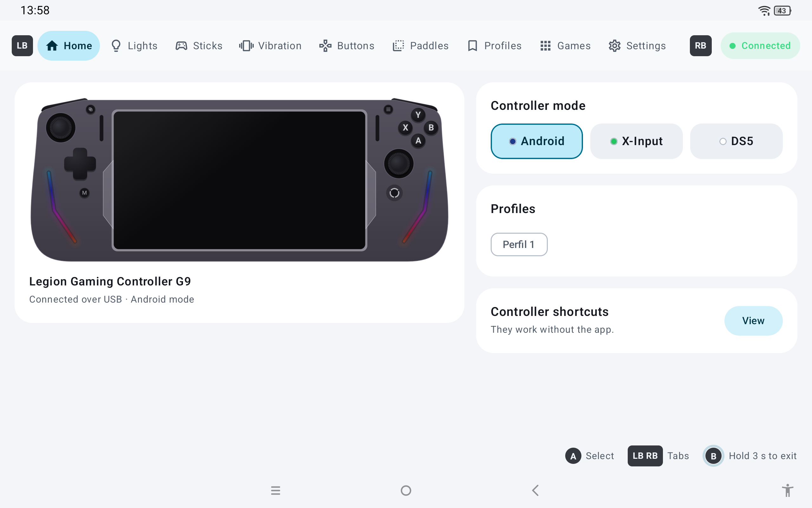
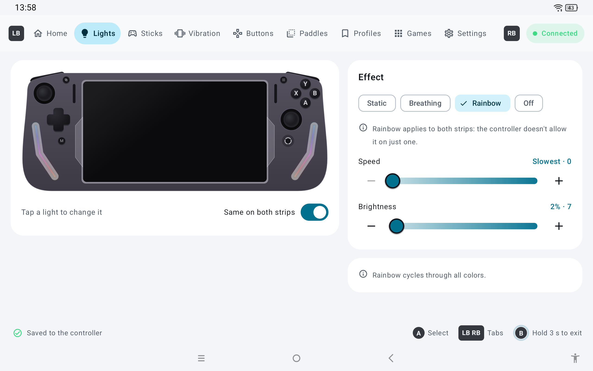
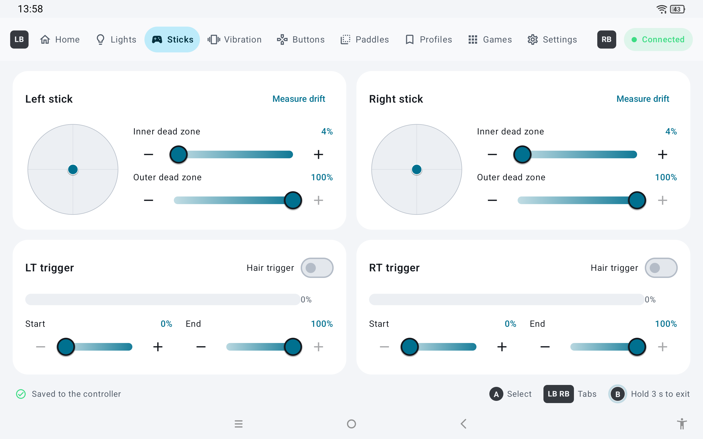
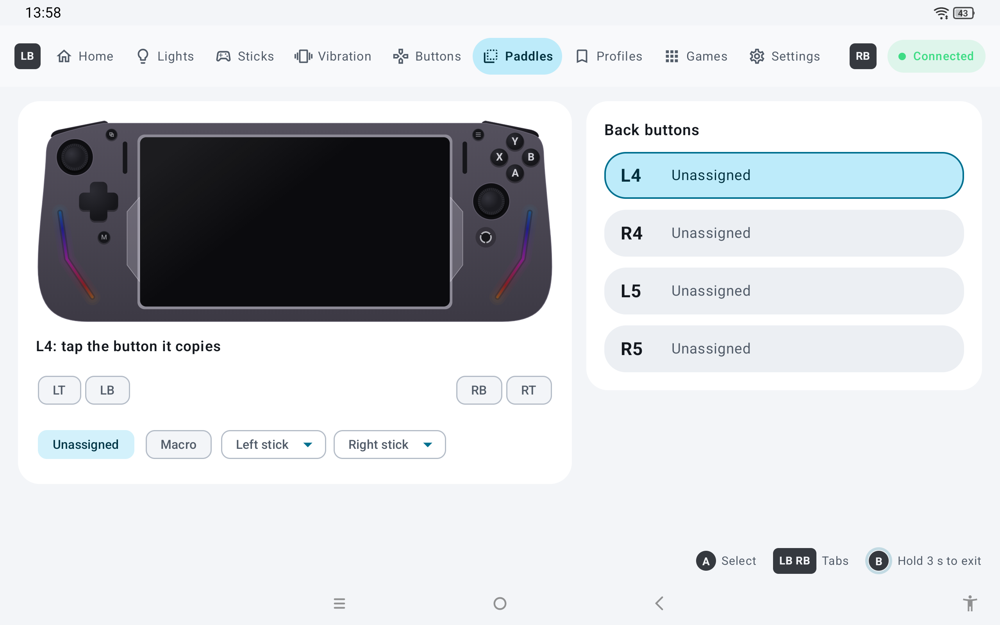
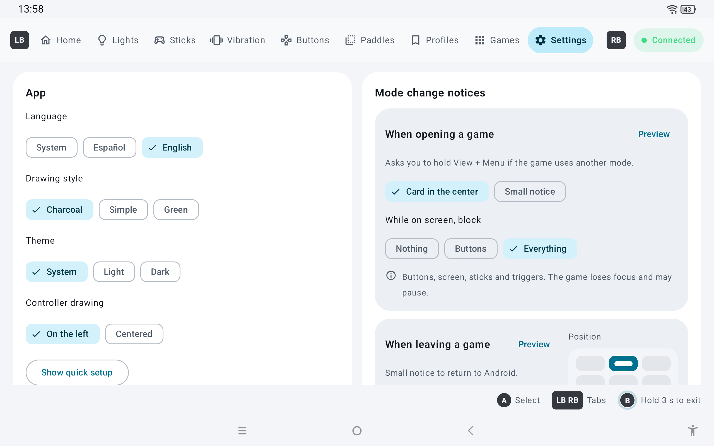

# G9 Control

**An open-source, account-free app to configure the Legion Gaming Controller G9 on the Lenovo Legion Y700 Gen 3 tablet.**

[Español](README.es.md)

> **Not affiliated with Lenovo.** "Legion" and "Lenovo" are trademarks of Lenovo. This is an independent, unofficial app. It talks to the controller over USB with a protocol reconstructed by studying the official app and testing the controller; it contains no code or assets from the official app.

> **This app is vibe-coded.** Every line of code, the protocol research and this README were written by Claude (Anthropic's AI) through Claude Code. I didn't write the code: I described what I wanted, tested every build on my own tablet and controller, and reported what worked and what didn't.



## Why

The official Legion app works, but it requires an account and comes with a launcher and a lot of extras. G9 Control does one thing: configure the controller. No account, no internet access, no ads.

It also does a few things the official app can't:

- **Switches to DS5 mode by software.** The official app sends a mode that leaves the G9 in Xbox mode.
- **Switches mode automatically per game** (X-Input or DS5), with an on-screen guide to get back to Android mode.
- **Records macros with the controller itself**, with a timeline editor, and lets back buttons copy Home or stick diagonals.
- **Profiles** with file backup, **stick drift measurement**, and **full navigation with the controller**.
- **Careful with the controller's memory**: it only writes what changed, after a short pause, and never writes in a loop.

## Features

| | |
|---|---|
| **Lights** | Both light strips and the Home button: static, breathing, rainbow, off; color, speed and brightness. |
| **Sticks and triggers** | Inner and outer dead zones with a live preview, trigger ranges, hair trigger, drift measurement. |
| **Vibration** | Five levels per side, test with the triggers. |
| **Buttons** | Button test, A↔B / X↔Y swap, D-pad diagonal lock, left stick ↔ D-pad swap. |
| **Paddles** | Assign L4, R4, L5, R5 to any button (including Home and stick directions) or to a macro. |
| **Profiles** | Save, apply and back up complete configurations. |
| **Games** | Choose which mode each app opens in; the controller switches when you open it. |
| **Game panel** | Hold the Legion button (or L3 + R3) in any app: a panel like Android's quick settings, with brightness and volume sliders, screenshot, Game Assistant, performance, bypass, 16:9 screen, Back, Home, Recents, quick settings and controller mode. Use the stick, D-pad, LB/RB or touch, without taking focus from the game. |
| **Screenshots** | Game-only (no pointer or overlays), with a thumbnail notice and a sound like the Switch. Legion + RB; hold RB for a burst. |
| **Performance** | Power saving, Balanced or Beast (Game Assistant's modes) from the controller, without touching the screen. Needs Shizuku. |
| **Bypass charging** | While gaming plugged in, the charger powers the tablet and the battery doesn't charge or heat up. Manual (also from the panel) or automatic, with the minimum battery and temperature you choose. Needs Shizuku. |
| **Charge limit** | While plugged in, at the level you choose (70 to 90 %) bypass turns on: the battery stops charging. ZUI's always stops at 80 %. Needs Shizuku. |
| **16:9 screen** | For an external monitor: the picture fills it with no borders. |
| **External monitor** | When connected in mirror mode it switches to 16:9 by itself (on every monitor or per monitor) and back to 16:10 when unplugged. Meanwhile the tablet's screen can be dimmed, backlight-off or off (the last two need Shizuku). |
| **Legion button** | Tap: Back. Hold: game panel. With RB: screenshot. With LB: hold Back (quits the game in Dolphin; with Shizuku). While streaming from a PC (Artemis, Moonlight…) it's the guide button. |
| **Auto brightness in games** | Game Assistant turns it off when a game starts; G9 Control can leave it as it is. |
| **Another controller** | If you play with another controller (an 8BitDo, for example), the G9 doesn't switch mode or ask to go back to Android. |
| **Swapped volume** | Optional: the tablet's lower button turns the volume up and the upper one turns it down. |
| **Quick settings** | Android, X-Input and DS5 tiles. |
| **Languages** | English and Spanish. |

<p>
 
 
</p>

## Requirements

- Lenovo Legion Y700 Gen 3 with the Legion Gaming Controller G9 (the controller is made for this tablet).
- Tested with controller firmware 0.52 on ZUI 17 (Android 15). Android 10 or later.

## Install

1. Download `G9Control-x.y.z.apk` from [Releases](../../releases).
2. Open it on the tablet. If Android asks, allow installing apps from that source.
3. Open G9 Control. A quick setup guides you through the rest:
   - Dock the tablet in the G9 in **Android mode** (dark blue indicator). If it's in X-Input (green) or DS5 (white), hold **View + Menu** for about 2 seconds.
   - When Android asks for USB access, check **Always** and accept.
   - Optional: turn on the **accessibility service** for automatic switching (see below).
   - Optional: add the **Android / X-Input / DS5** tiles to quick settings.

### About the accessibility service

Automatic switching per game, the View + Menu guide, the quick settings tiles (from X-Input/DS5), the game panel, the Legion button, the swapped volume, automatic bypass, the charge limit and the external monitor use an accessibility service. Android starts it by itself when the tablet turns on: you don't need to open the app. This is what it does with it:

- **Sees which app is on screen** (window changes), to switch mode per game.
- **Sees the controller's buttons**, to track View + Menu for the guide, to run the game panel and the Legion button and, only if you choose to, block buttons while a notice is on screen. If you swap the volume, also the tablet's volume buttons. While the panel is open it also sees the sticks and D-pad, to move around it (they don't reach the game).
- **Takes screenshots when you ask** (from the panel, with Legion + RB, by holding L3 + R3 or with M twice in DS5): only of the game window, saved on the tablet (Pictures/Screenshots). While the performance mode changes it shows a frozen picture of the game, kept only in memory and never saved.
- **Performs gestures only on the tablet's Game Assistant** (Lenovo ZUI): the swipe that opens its panel from the side tab and the tap on its performance button.

To capture only the game window, Android requires the permission to view window content: without it, Android won't say which window is the game. That's why Android warns that the app can read the screen when you turn it on. G9 Control uses that permission only for the list of windows (which one is the game): it doesn't read their text or buttons and doesn't see what you type. The app has no internet permission, so nothing leaves the tablet.

If Android shows **"Restricted setting"** when turning it on: Settings → Apps → G9 Control → ⋮ (top right) → **Allow restricted settings**, then try again.

### Optional: Shizuku and one adb permission

Almost everything works with nothing extra. Two things need more than a regular app's permissions:

- **16:9 screen, brightness from the panel and auto brightness in games:** a permission you grant once from a computer; it stays (also after a reboot or an update):
  `adb shell pm grant io.github.sudodiego.g9control android.permission.WRITE_SECURE_SETTINGS`
- **Bypass charging, charge limit, performance mode, hiding Game Assistant, holding Back and turning the tablet's screen off with a monitor:** [Shizuku](https://shizuku.rikka.app/) running (it must be started after every reboot). In Settings → Permissions, tap **Grant permission**. The ROM only lets system apps use these, and Shizuku's shell counts as one. G9 Control only asks it for a fixed list of commands: turn on or read bypass and ZUI's charge limit, show or hide Game Assistant, read its log to know the mode, hold Back, turn the panel (or just its backlight) off or on and, if the permission above is missing, change the screen size. Without Shizuku, what needs it is dimmed in the panel and choosing it opens Shizuku.

Settings → Permissions shows the state of all this and how to turn it on, and Home warns you if something you use is missing.

## Limitations

- **No firmware updates.** That's intentional: a failed update can brick the controller. If you ever need one, use the official Legion app once.
- The app can only configure the controller in **Android mode**. In X-Input and DS5 modes the controller has no configuration channel, so switching back to Android is always done with View + Menu (the app guides you).
- In Android mode, games vibrate the tablet, not the controller (firmware behavior).
- In Android mode, M twice takes the system screenshot (Android handles it before any app). For a clean screenshot, Legion + RB.
- Android lets the app take at most one screenshot per second: bursts go at that pace.
- Holding the Legion button for 5 seconds turns the G9 off (firmware behavior).
- While streaming from a PC, the Legion button goes to the PC: Legion + RB doesn't take screenshots there.
- Some open apps close when switching between 16:9 and 16:10 (Dolphin, for example): switch before opening them.
- With a monitor, if the tablet's screen stays off by mistake (for example, if G9 Control was force-closed), **pressing the power button twice** always turns it back on. Unplugging the monitor works too. With the monitor on the USB-C port the G9 doesn't respond: use another controller (Bluetooth, for example).

## Build from source

Android Studio (or just the JDK it ships with):

```
./gradlew assembleRelease
```

Without a `keystore.properties` file the release build is signed with the debug key. Protocol notes and everything that was tested are in [CONTEXTO.md](CONTEXTO.md) (in Spanish).

## License

[GPL-3.0](LICENSE). You can use, study, modify and share it; modified versions must stay open source under the same license.
